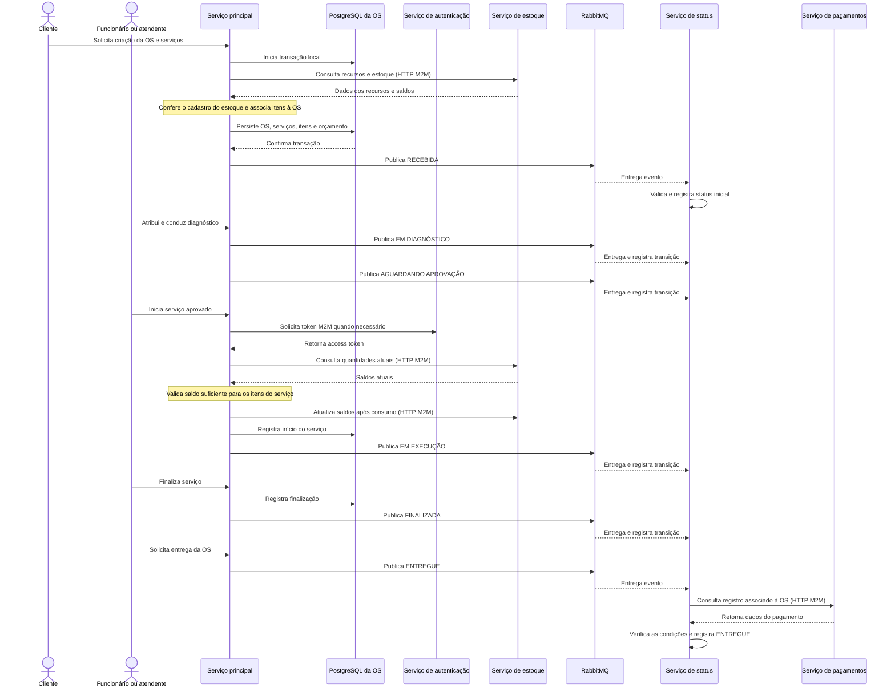

# Arquitetura de microsserviços e Saga Pattern

## 1. Objetivo deste documento

Este documento apresenta a arquitetura distribuída da solução de ordens de serviço automotivas, com ênfase em microsserviços e no padrão Saga. O foco é o serviço principal deste repositório: a API responsável por criar a ordem de serviço (OS), criar seus serviços solicitados e coordenar as integrações necessárias para que a OS percorra seu ciclo de vida.

Além da visão do serviço principal, são descritas as responsabilidades dos serviços de estoque, status, pagamentos e autenticação, a comunicação M2M, o uso do RabbitMQ e os conceitos de Saga efetivamente aplicados no fluxo.

## 2. Visão geral da solução

A aplicação principal foi ampliada com três microsserviços de domínio: **estoque**, **atualização de status** e **pagamentos**. O serviço de ordens de serviço existente coordena o fluxo de negócio e integra os demais componentes. A solução também conta com um **serviço de autenticação**, que emite tokens para autenticar usuários e chamadas entre serviços.

| Serviço ou componente | Responsabilidade |
| --- | --- |
| Serviço principal de ordens de serviço | Cria a OS e os serviços solicitados, mantém os dados do seu domínio, aplica as regras locais e coordena as etapas do fluxo. |
| Microsserviço de estoque | Mantém recursos e saldos de estoque; responde a consultas e atualizações solicitadas pelo serviço principal. |
| Microsserviço de status | Consome eventos de status, valida transições e mantém o histórico da OS e dos serviços solicitados. |
| Microsserviço de pagamentos | Cria e consulta registros de pagamento associados às OS. |
| Serviço de autenticação | Emite tokens utilizados pelos projetos para autenticação de usuários e comunicação M2M. |
| RabbitMQ | Transporta eventos de status entre o serviço principal e o serviço de status. |
| SonarQube e sua base de dados | Apoiam a análise de qualidade do código no ambiente da equipe. |

Cada serviço mantém seu próprio contexto de dados. A integração entre os domínios ocorre por APIs HTTP autenticadas ou por mensagens, sem acesso direto de um serviço à base de dados de outro.

### 2.1. Ambiente da entrega

A solução está implantada em servidor próprio, em um único cluster Kubernetes com **13 pods**, conforme o ambiente da equipe. Nesse contexto estão os serviços principal, de status, de estoque, de pagamentos e de autenticação, com bases de dados próprias, além do RabbitMQ, do SonarQube e da base do SonarQube.

Os projetos são executáveis e implantáveis separadamente, enquanto o cluster reúne os componentes necessários para o funcionamento integrado da solução.

## 3. Serviço principal: papel de orquestrador

O serviço deste repositório é o ponto de coordenação do processo da OS. Ele:

- recebe a solicitação de criação da OS;
- valida os dados e associa cliente, veículo, serviços, recursos e peças;
- calcula os custos e o orçamento com base nos dados disponíveis;
- consulta o serviço de estoque por meio de chamadas HTTP M2M;
- persiste a OS e os dados que pertencem ao seu domínio em seu PostgreSQL;
- publica eventos de status no RabbitMQ à medida que o fluxo avança;
- inicia a operação de consumo de recursos no estoque quando o serviço solicitado começa.

O serviço principal coordena o fluxo, mas não centraliza todos os dados: o estoque, o histórico de status e os pagamentos continuam sob responsabilidade de seus respectivos serviços.

## 4. Fluxo de negócio da OS



### 4.1. Passo a passo

1. **Criação:** o cliente envia os dados da OS, do veículo e dos serviços solicitados. O serviço principal procura o cliente, cria a OS e seus itens em uma transação local.
2. **Associação de recursos:** durante a criação, o serviço consulta o serviço de estoque para obter os recursos e verificar a existência dos registros de estoque necessários. Os itens de estoque são associados aos serviços solicitados.
3. **Status inicial:** depois da confirmação da transação local, o serviço publica `RECEBIDA` no RabbitMQ. O serviço de status recebe o evento e registra a etapa inicial.
4. **Diagnóstico e aprovação:** atribuição, diagnóstico, revisão, aprovação ou cancelamento produzem as respectivas atualizações de status para acompanhamento pelo serviço de status.
5. **Início e consumo:** ao iniciar um serviço, o serviço principal consulta os saldos atuais, valida se há quantidade suficiente para os itens e solicita ao serviço de estoque os novos saldos após o consumo. Em seguida, registra o início e publica `EM EXECUÇÃO`.
6. **Finalização:** ao concluir o trabalho, registra a data de finalização e publica `FINALIZADA`.
7. **Entrega:** a solicitação de entrega publica `ENTREGUE`. O serviço de status valida as condições do fluxo e consulta o serviço de pagamentos para verificar o registro vinculado à OS antes de registrar a entrega.

A consulta de estoque acontece durante a preparação da OS para identificar e associar recursos. A validação do saldo suficiente e a atualização das quantidades ocorrem no início do serviço solicitado, próximo ao momento em que os recursos são consumidos.

### 4.2. Estados utilizados no fluxo

O serviço principal publica estados para a OS e/ou para os serviços solicitados conforme a etapa. Entre os estados presentes na aplicação estão:

| Status | Etapa representada |
| --- | --- |
| `RECEBIDA` | OS recebida e inicializada no fluxo de status. |
| `EM DIAGNÓSTICO` | Serviço solicitado em diagnóstico. |
| `AGUARDANDO APROVAÇÃO` | Diagnóstico enviado para decisão do cliente. |
| `APROVADO` | Serviço solicitado aprovado. |
| `CANCELADO` | Serviço solicitado cancelado. |
| `EM EXECUÇÃO` | Serviço iniciado após validação e atualização do estoque. |
| `FINALIZADA` | Serviço solicitado concluído. |
| `ENTREGUE` | Etapa de entrega, validada pelo serviço de status. |

O microsserviço de status é responsável por validar a progressão e persistir o histórico dessas etapas.

## 5. Microsserviços e comunicação M2M

**M2M (Machine-to-Machine)** em microsserviços é a troca de dados e a autenticação direta entre dois ou mais serviços de backend, sem a intervenção ou o contexto de um usuário final humano. A identidade usada na comunicação é a do serviço que faz a chamada, e não a de uma pessoa que esteja operando a aplicação.

Essa comunicação permite que cada serviço mantenha responsabilidade e persistência próprias, expondo contratos definidos para os demais componentes.

### 5.1. M2M por HTTP

As chamadas HTTP entre serviços utilizam o servidor de autenticação para obter tokens de serviço. No serviço principal:

1. o cliente HTTP solicita um token ao endpoint configurado em `AUTHORIZATION_SERVER_URL`, no caminho `/auth/token`;
2. a solicitação é autenticada com credenciais M2M;
3. o serviço recebe `accessToken` e `expiresIn`;
4. o token é mantido em cache na instância do cliente até próximo do vencimento;
5. as chamadas protegidas ao serviço de estoque enviam o token no cabeçalho `Authorization: Bearer <token>`.

O mesmo conceito de identidade de serviço é utilizado nas integrações HTTP dos outros componentes, como a consulta do serviço de status ao serviço de pagamentos. Dessa forma, a autenticação M2M é centralizada no servidor de autenticação, em vez de depender do contexto de um usuário final.

### 5.2. M2M por mensageria

Para publicar atualizações de status, o serviço principal utiliza RabbitMQ. Nesse caso, a integração é assíncrona: o serviço publica uma mensagem e o consumidor processa o evento sem manter a mesma chamada HTTP aberta. A identidade e o acesso à mensageria são tratados na infraestrutura RabbitMQ; o evento também contém metadados para correlação com a OS.

## 6. Saga Pattern aplicado

Uma **Saga** modela uma operação de negócio distribuída como uma sequência de transações locais executadas por serviços independentes. Em vez de uma única transação de banco de dados envolvendo todos os serviços, cada participante confirma suas alterações no próprio domínio e o processo avança por chamadas ou eventos.

O fluxo da OS aplica os seguintes conceitos:

### 6.1. Orquestração

O serviço principal coordena as etapas relacionadas à OS. Ele define quando consultar o estoque, quando atualizar os saldos e quando publicar os estados associados à evolução do atendimento. O serviço de status, por sua vez, mantém o histórico e valida a progressão dos status de acordo com suas regras.

### 6.2. Transações locais por serviço

Na criação, o serviço principal agrupa as gravações locais da OS, serviços solicitados, itens e orçamento em uma transação do PostgreSQL. O estoque atualiza suas quantidades em sua própria base; o serviço de status persiste o histórico no próprio armazenamento; e o serviço de pagamentos mantém os registros de pagamento sob sua responsabilidade.

Essa separação preserva os limites de cada domínio e permite que cada serviço evolua sem compartilhar o esquema interno de outro.

### 6.3. Eventos e processamento assíncrono

As alterações de status são publicadas no RabbitMQ pelo padrão `requested-service.status`. O consumidor de status processa cada evento e atualiza o histórico. Esse mecanismo desacopla temporalmente o produtor do consumidor e permite que as etapas de status sejam processadas independentemente do ciclo da requisição que iniciou a mudança.

### 6.4. Consistência eventual

Como a publicação e o consumo são etapas separadas, o estado da OS e seu histórico distribuído podem ser atualizados em momentos diferentes. O fluxo converge conforme os eventos são consumidos e as validações de status são concluídas.

### 6.5. Correlação e rastreabilidade

O produtor publica mensagens persistentes com:

- `messageId` único por mensagem;
- cabeçalho `x-saga-id` com o número da OS;
- padrão de evento `requested-service.status`;
- payload com número da OS, número do serviço solicitado quando aplicável e status.

Esses identificadores relacionam as mensagens às etapas de uma mesma execução de negócio e permitem rastrear as atualizações correlacionadas.

Exemplo conceitual do payload:

```json
{
  "requested_service_number": 1042,
  "service_order_number": 501,
  "status": "EM DIAGNÓSTICO"
}
```

### 6.6. Progressão controlada

O serviço de status valida a transição antes de acrescentá-la ao histórico. Por exemplo, a execução é precedida pela aprovação e a finalização sucede a execução. Na etapa de entrega, o serviço de status consulta o pagamento associado e valida as condições do fluxo antes de registrar `ENTREGUE`.

O consumidor de status também aplica os mecanismos de processamento de mensagens descritos em sua documentação, incluindo deduplicação por identificador, tentativas limitadas para falhas transitórias e encaminhamento de mensagens não processadas para dead-letter queue.

## 7. Dados e tecnologias por serviço

| Serviço | Persistência e tecnologia descritas nos projetos | Dados principais |
| --- | --- | --- |
| Serviço principal | PostgreSQL, TypeORM e migrações | OS, serviços solicitados, itens, orçamento, usuários e veículos do domínio. |
| Estoque | PostgreSQL | Recursos e quantidades disponíveis. |
| Status | MongoDB | Histórico de status da OS e dos serviços solicitados, além de controle de mensagens processadas. |
| Pagamentos | PostgreSQL | Associação entre OS e ordem de pagamento, com consulta ao provedor de pagamentos. |
| Autenticação | PostgreSQL | Usuários, credenciais e permissões usados na autenticação. |

Cada serviço acessa sua própria persistência por meio de seus adaptadores. A leitura de dados de outro domínio é feita por API, não por consulta direta ao banco alheio.

## 8. Arquitetura interna deste repositório

O serviço principal é implementado com NestJS e TypeScript, utilizando uma organização que separa os casos de uso das interfaces e detalhes de infraestrutura:

| Módulo ou camada | Função |
| --- | --- |
| `src/core/application` | Casos de uso de autenticação, usuários, veículos, recursos, serviços e ordens de serviço. |
| `src/frameworks/primary/controllers` | Controllers REST para clientes, funcionários, autenticação, saúde e demais operações. |
| `src/frameworks/primary/dto` | Contratos de entrada e saída e validação dos dados. |
| `src/frameworks/primary/guards` | Validação de JWT e controle de permissões. |
| `src/frameworks/secondary` | Entidades e adaptadores de persistência do domínio. |
| `src/modules/httpClient` | Clientes HTTP autenticados para estoque e produtor RabbitMQ para status. |
| `src/infrastructure/database` | Configuração do PostgreSQL e migrações TypeORM. |
| `src/infrastructure/rabbitmq.config.ts` | Padrão do evento e opções de fila utilizadas pelo produtor. |

## 9. API principal

A API escuta a porta `3000` por padrão. O Swagger é disponibilizado em `/api`, e o documento OpenAPI em `/api-json`.

### 9.1. Operações de ordem de serviço

| Método | Rota | Operação |
| --- | --- | --- |
| `POST` | `/services-order` | Cria uma OS e seus serviços solicitados. |
| `GET` | `/services-order/me` | Lista as OS do usuário autenticado. |
| `GET` | `/services-order/:id` | Consulta os detalhes de uma OS. |
| `GET` | `/services-order/requested/:id` | Consulta os dados de um serviço solicitado. |
| `GET` | `/services-order/requested/:id/items` | Lista os itens associados ao serviço solicitado. |
| `POST` | `/services-order/requested/:requestedServiceId/approve` | Aprova um serviço solicitado. |
| `POST` | `/services-order/requested/:requestedServiceId/cancel` | Cancela um serviço solicitado. |
| `GET` | `/services-order` | Lista OS para o fluxo operacional. |
| `POST` | `/services-order/requested/:requestedServiceId/assign` | Atribui um funcionário ao serviço solicitado. |
| `POST` | `/services-order/requested/:requestedServiceId/review` | Envia o diagnóstico para a etapa de aprovação. |
| `POST` | `/services-order/requested/:requestedServiceId/start` | Valida estoque, atualiza saldos e inicia o serviço. |
| `POST` | `/services-order/requested/:requestedServiceId/finish` | Registra a finalização do serviço. |
| `POST` | `/services-order/:id/vehicle-arrived` | Registra a chegada do veículo. |
| `POST` | `/services-order/:id/deliver` | Solicita a entrega da OS e publica o status correspondente. |

O serviço também disponibiliza operações de cadastro e consulta para usuários, veículos, recursos e serviços. A lista completa de parâmetros, esquemas e respostas está disponível no Swagger.

### 9.2. Exemplo de criação de OS

```json
{
  "userDocument": "12345678900",
  "vehicle_id": 1,
  "services": [
    {
      "id": 1,
      "parts": [
        { "id": 2 }
      ]
    }
  ]
}
```

Resposta de sucesso:

```json
{
  "id": 123,
  "message": "Ordem de serviço criada com sucesso."
}
```

## 10. Execução e configuração

### 10.1. Requisitos

- Node.js e npm;
- PostgreSQL acessível;
- RabbitMQ acessível;
- serviço de autenticação acessível para emissão de tokens M2M;
- serviço de estoque acessível para os fluxos de consulta e consumo.

### 10.2. Variáveis de ambiente principais

| Variável | Finalidade |
| --- | --- |
| `PORT` | Porta HTTP da aplicação; padrão `3000`. |
| `DB_HOST` | Host do PostgreSQL do serviço principal. |
| `DB_PORT` | Porta do PostgreSQL; padrão `5432`. |
| `DB_NAME` | Nome da base de dados do serviço principal. |
| `DB_USER` | Usuário do PostgreSQL. |
| `DB_PASSWORD` | Senha do PostgreSQL. |
| `JWT_SECRET` | Segredo de assinatura e validação dos JWTs usados pela aplicação. |
| `AUTHORIZATION_SERVER_URL` | URL base do servidor de autenticação M2M. |
| `STOCK_SERVICE_URL` | URL base do microsserviço de estoque. |
| `RMQ_URL` | URL de conexão com RabbitMQ; padrão local `amqp://localhost:5672`. |
| `STATUS_QUEUE_NAME` | Nome da fila de status usada pelo produtor RabbitMQ. |

Segredos e credenciais devem ser disponibilizados pelo ambiente de execução, sem serem versionados.

### 10.3. Comandos

```bash
npm install
npm run dev
```

Para build, validação de tipos, lint e testes:

```bash
npm run build
npm run tsc
npm run lint
npm test
npm run test:cov
```

O projeto também disponibiliza Docker Compose para executar a aplicação com PostgreSQL. A documentação de configuração local está no [README.md](./README.md).

## 11. Containerização, implantação e qualidade

Este repositório contém:

- `Dockerfile` para construção da imagem da aplicação;
- `docker-compose.yml` para execução local da aplicação e PostgreSQL;
- manifests Kubernetes em `k8s/`;
- configuração Terraform em `infra/` para provisionamento de recursos Kubernetes.

O deployment da aplicação utiliza `/health` como verificação de disponibilidade. A aplicação expõe a documentação Swagger e inicializa instrumentação de tracing. O ambiente da equipe complementa a operação com SonarQube e seu banco de dados.

## 12. Benefícios demonstrados pela implementação

- **Responsabilidades delimitadas:** ordem de serviço, estoque, status, pagamentos e autenticação são tratados por serviços com objetivos claros.
- **Autonomia de dados:** cada serviço mantém sua base e evita acoplamento por esquema compartilhado.
- **Integração por contratos:** APIs HTTP autenticadas e eventos RabbitMQ conectam os serviços sem acesso direto aos bancos.
- **Coordenação explícita:** o serviço principal centraliza a sequência de ações de negócio da OS.
- **Processamento assíncrono de status:** o RabbitMQ desacopla a publicação da atualização e seu processamento.
- **Rastreabilidade:** identificador da OS nos eventos, identificador único por mensagem e histórico de transições tornam o fluxo acompanhável.
- **Validação de domínio:** as regras de estoque e de transição de status são aplicadas pelos serviços responsáveis.
- **Segurança entre serviços:** a autenticação M2M centraliza a emissão e o uso de tokens de serviço nas chamadas HTTP.
- **Implantação independente:** os componentes são empacotados e implantáveis em serviços separados no cluster.
- **Suporte à qualidade e operação:** migrações versionadas, testes automatizados, Swagger, health check, tracing e SonarQube compõem as ferramentas disponíveis no projeto.

## 13. Projetos e documentação de referência

As responsabilidades e integrações dos serviços foram alinhadas às documentações README dos projetos relacionados:

- [`15soat-payment-service/README.md`](https://github.com/TiagoSimionato/15soat-payment-service) — criação e consulta de pagamentos;
- [`15soat-stock-update-service/README.md`](https://github.com/TiagoSimionato/15soat-stock-update-service) — recursos, consulta e atualização de estoque;
- [`soat15-status-update-service/README.md`](https://github.com/nathaliadutra15/soat15-status-update-service) — eventos, histórico e validação de estados;
- [`soat15-serverless/README.md`](https://github.com/nathaliadutra15/soat15-serverless) — autenticação e emissão de tokens.

Para os comandos básicos e a configuração inicial deste repositório, consulte também o [README.md](./README.md).
